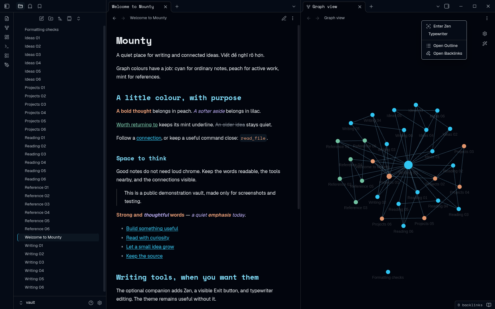

# Mounty-tool 0.5.0

Optional tools for connected notes: **manual graph categories and colours**, plus
retained Zen/writing controls. Mounty and Omarchy remain standalone CSS themes
with the same appearance at matching releases. The tool can also colour native
Graph groups without replacing your theme. No automatic classification or bulk
note edits are included.

This product's current source is https://github.com/sonlndv/Mounty-tool .
Versioned runtime files are available from the [0.5.0 release](https://github.com/sonlndv/Mounty-tool/releases/tag/0.5.0) when published. Official plugin-directory
submission remains maintainer-owned and pending; a release/source file is not activation.
The repository was renamed in place; its history and older releases remain.

## One property, one category

In Settings → Mounty-tool → **Graph categories**, add a meaningful stable key,
a label, and six-digit dark/light hex colours. `note` starts cyan; `restaurant`
is an editable mint example, not an automatic classification. There is no hard
category-count limit. Keep colour meanings deliberate rather than inventing a
rainbow for each folder. Keys are trimmed, 1–64 characters, unique ignoring case,
and exclude quotes/control characters. Labels are 1–80 characters; invalid input
gets a visible notice instead of being silently saved. Existing keys are immutable
in the editor; editing a label or colour does not change any note values.

Example property (you assign it deliberately to one note):

```yaml
mounty-graph: restaurant
```

Run **Mounty-tool: Assign or clear graph category for current note**, or use the
pen-ribbon tools menu. The modal pins the exact Markdown path and existing value.
Choose one category, then explicitly Assign, or explicitly Clear mounty-graph.
Cancel is the default and writes nothing. The public `processFrontMatter` API
changes/deletes only this property, preserving body and unrelated properties;
Obsidian may normalize frontmatter formatting. Full-file byte equality is not
promised for an explicit assignment. Changed/missing/renamed/replaced files,
malformed YAML, ambiguous list/object/nonstring values and unknown choices are
refused with a notice. Fix malformed values yourself; the tool will not convert
a list or guess a category. There are no startup/file-open writes or content scans.

Removing a category edits **only plugin preferences**. Existing note properties
stay unmatched until you deliberately change or clear them. Labels/colours and
category deletion never edit notes or native Graph automatically.

## Preview, then Apply to native GLOBAL Graph

Open native Graph explicitly. Run **Preview applying graph category colours**
from commands, settings or the pen menu. The preview shows current dark/light
scheme, exact escaped queries/swatches and how many old groups will be retained.
Cancel remains default. **Apply category colours** prepends category rules,
so they take priority over overlapping existing rules, preserving all other
groups in their existing order and retaining search/filter/forces/zoom/layout.
A restaurant overlapping an old active-work group gets restaurant's one colour.
Whole-value property matching keeps `note` distinct from `notebook`.

Changing colours/categories or switching scheme saves only preferences: **preview
and Apply again** to update Graph. Native custom group colours do not remap
implicitly on theme/CSS changes. Repeated applies replace exact unedited owned
snapshots without duplication. Foreign exact-query conflicts are refused; resolve
those in native Graph before a fresh preview. A prefix is not ownership.

**Preview removing unedited tool-owned graph rules** is explicit undo. It removes
only exact, unique, unchanged persisted tool-owned rule snapshots. Foreign or
edited rules and all non-group options remain. Ownership survives reload/disable.
Ambiguous duplicated exact snapshots are refused rather than guessed. Category
or group/scheme/target changes since preview require a fresh preview. Own saves
and Graph actions are serialized. Failed operations never report success and
restore their changed groups only when the live state still exactly matches
that operation's output; newer user state is left untouched. Inspect Graph and
saved ownership after an error, especially if storage/core persistence failed.

### Compatibility boundary

This uses **non-public, narrowly validated** global Graph `dataEngine` interop,
feasibility-probed in Obsidian **1.14.5**: `getOptions`, partial
`setOptions({colorGroups})`, `onOptionsChange`, and optional debounce flush.
Generic leaf setState is not used; direct graph.json writes are not used.
Unsupported/missing/detached/local Graph shapes fail closed with an explicit
Open global Graph affordance if its core command exists. The tool never enables
a core plugin. Live group state is verified; native core disk persistence can
finish asynchronously and is not a transactional graph-file guarantee.
Note assignment, cancellation/clear, malformed/list property refusal, managed rule apply/removal and dark/light node colours have been exercised in an isolated synthetic Obsidian1.14.5 desktop vault. Physical mobile/IME, detached editors and remote sync are not certified.

## Retained writing tools




These older writing captures are not proof of the new Graph UI or category
implementation. Zen always starts OFF, with visible Exit Zen and command exit.
Typewriter and Follow Omarchy colours remain OFF by default; width is standard,
hide filename title OFF. Existing saved values are retained. Native text sizing,
IME/selection/manual-scroll/menu/modal guards, no Escape hijack, main-document
menu ownership and unload cleanup remain. No default hotkeys or automatic panes.
Follow-colours still needs the separately reviewed desktop hook; this plugin
never executes shell or switches OS theme and cannot promise phone sync.

Settings separate **Writing** and **Graph categories**. Stable technical identity
and existing hotkeys/preferences remain in `omarchy-writing`. Commands:

- `omarchy-writing:open-writing-tools` (pen ribbon; now includes Graph actions)
- `omarchy-writing:toggle-zen`
- `omarchy-writing:toggle-typewriter`
- `omarchy-writing:assign-graph-category`
- `omarchy-writing:preview-graph-categories`
- `omarchy-writing:preview-remove-graph-categories`

## Manual install / upgrade

After review/publication, copy release **main.js, styles.css, manifest.json** to
`<vault>/.obsidian/plugins/omarchy-writing/`. Disable the old manual companion
before replacing files in that SAME folder, **preserve data.json**, then explicitly
re-enable Mounty-tool. Never create a second Mounty-tool/mounty-zen ID or enable
two copies. Theme updates do not install tools. Verify ID/version before any future
official directory install; none is claimed available here. See
[migration](docs/MIGRATING-TO-MOUNTY.md) and [listing status](docs/COMMUNITY-LISTINGS.md).

## Privacy, source, tests and rollback

Offline runtime: no account, network, telemetry, shell, dependencies/build step,
self-updater or dependency installer. Obsidian provides the SDK. The ONLY deliberate
note mutation is the selected note's mounty-graph frontmatter via the public API;
the ONLY deliberate Graph mutation is partial native colour groups after preview.
Own category/ownership/writing preferences are stored with saveData. There are
no vault-content scans, bulk tags, taxonomy migrations or other-plugin writes.

```sh
node --check main.js
node --test tests/*.cjs
```

CI uses Node22 without installing packages. SDK-free tests are not native UI
proof. Inherited minimum metadata remains 1.5.0, not freshly tested across old
versions. Graph interop targets main-window 1.14.5 shapes; physical phone, detached
windows, mobile IME and sync are not certified. The old generator/0.4.1 companion
in obsidian-omarchy-theme is preserved history, not the future plugin source or
byte-parity authority for this functional release. Generated 0.4.1 palette CSS
remains an exact prefix; no fonts/theme palettes/images/licenses are recoloured.

Before rollback, explicitly preview/remove unedited owned rules if desired;
disabling alone does not delete saved note categories or Graph groups. Disable,
restore owned backed-up runtime in the same folder and retain data.json. Older
versions ignore new Graph fields and cannot manage these rules; native Graph
can be edited manually. Never erase notes, Groups, layout or other preferences.
Manual installation into your chosen vault is a separate deliberate action. No directory approval or live-vault activation is implied by source publication.

Original author Le Son; [MIT LICENSE](LICENSE). Existing images/attribution remain.
